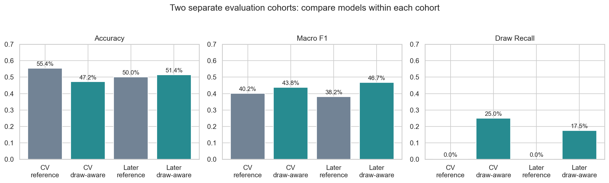
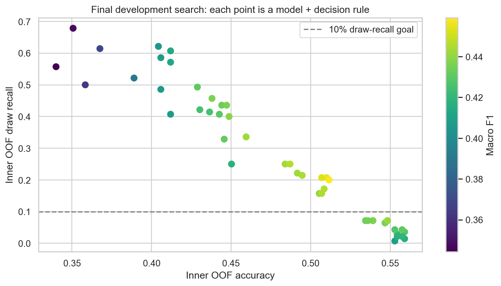
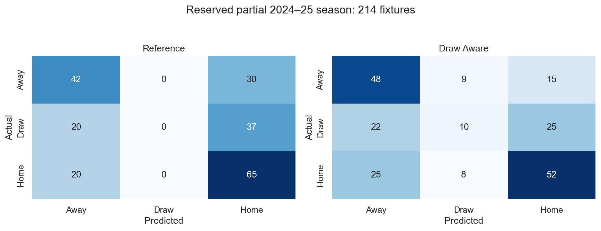
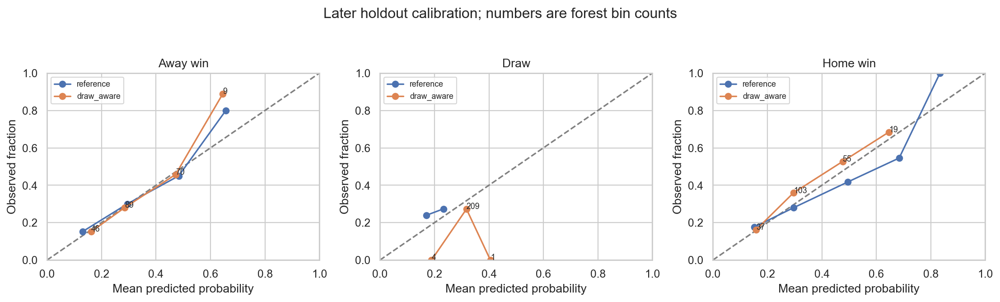

## Can we improve accuracy and recognize draws?

We tested the idea rather than promising a higher score. The new random forest recognizes draws and improves macro F1. Its later holdout accuracy is 51.4% versus 50.0% for a refitted reference on exactly the same 214 matches—a gain of only three correct predictions. The approximate paired week-block 95% accuracy-difference interval is -3.1 to +6.1 percentage points, so this is not convincing evidence of an accuracy improvement.

In nested chronological validation the draw-aware selection procedure lost accuracy (47.2% versus 55.4%), while draw recall rose from 0% to 25.0%. No tested configuration satisfied both our declared development goals. Therefore the new forest is a documented draw-sensitive alternative, not a proven replacement for the original probability model. We did not keep adjusting settings after the new holdout was opened.

## Why the original model never chose a draw

Draw probabilities were generally below the home-win or away-win probability. For example, probabilities [away=.36, draw=.30, home=.34] produce an away prediction even though a draw is plausible. A draw decision multiplier of 1.5 would choose draw using scores [.36,.45,.34], while the reported probabilities must remain [.36,.30,.34]. These scores are not calibrated probabilities.

Recognizing more draws can also produce more false draw predictions. The correct goal is not merely making the model say “draw”; it is showing the accuracy, precision, recall and probability-quality trade-offs on later data. Lecture 7 covers threshold-sensitive classification metrics and Lecture 9 covers logistic probabilities. The custom multiclass rule extends that idea; it is not a binary 0.5 cutoff.

## What changed, and how leakage was prevented

The first experiment is preserved. Its already-inspected 2023–24 test is now explicitly part of development, together with 2021–22 and 2022–23. A different, previously unevaluated set of 214 eligible completed 2024–25 fixtures is reserved for the final check, from August 16, 2024 through January 20, 2025. The snapshot has 219 completed fixtures that season; five lack enough prior team history. It is incomplete and not necessarily a contiguous league matchweek block; conclusions apply to these archived completed fixtures.

Ten outer chronological folds evaluate the complete selection procedure. Within each outer training set, three inner chronological folds choose both the model and the draw multiplier. All scaling and VIF pruning happen within the relevant training data. Date boundaries are saved and tested. No outer-validation outcome selects its own model or rule. Earlier observed match results may update later pre-match history, but never fitted coefficients within a fold.

The search includes eight regularized multinomial logistic configurations, two shallow trees and two forests. Logistic models compare signed differences with three additional pre-match inputs: absolute Elo gap, total recent goals scored, and total recent goals conceded. The aim is to represent team similarity and scoring environment; the result does not prove those features are beneficial. Logistic training draw weight is 1 or 1.5; tree/forest use balanced training weights. Each candidate also tries four decision multipliers, giving 48 model/rule combinations. No SMOTE or new advanced model family was added. Forest coverage in later lectures remains unverified locally, but it is part of the team's requested comparison.

The declared selector maximizes macro F1 among configurations with at least 10% inner draw recall and accuracy within two percentage points of the fixed reference. If none qualify, it reports failure and selects unconstrained macro F1 for a clearly labeled challenger. All ten outer searches and the final development search required that fallback. The originally chosen reference settings are fixed, although they were developed using some of these historical data; nested results are a diagnostic comparison, not fresh external evidence. The new later holdout is the separate final check.

## Nested chronological validation

| approach | accuracy | macro_f1 | draw_precision | draw_recall | log_loss |
| --- | --- | --- | --- | --- | --- |
| nested_argmax | 0.4778 | 0.4228 | 0.1930 | 0.1571 | 1.1564 |
| nested_draw_aware | 0.4717 | 0.4382 | 0.2121 | 0.2500 | 1.1564 |
| reference | 0.5544 | 0.4017 | 0.0000 | 0.0000 | 0.9636 |

These scores pool 653 outer-validation fixtures. “Nested argmax” uses the same selected model probabilities without the draw multiplier; “nested draw aware” uses the independently selected rule in each fold. Probability metrics are identical between those two decision policies. The selection procedure improves macro F1 but fails to maintain accuracy. This is why simply reporting the best development-search score would have been misleading.

## Reserved later-season results

| approach | accuracy | macro_f1 | draw_precision | draw_recall | log_loss |
| --- | --- | --- | --- | --- | --- |
| draw_aware | 0.5140 | 0.4668 | 0.3704 | 0.1754 | 1.0119 |
| same_model_argmax | 0.5140 | 0.4668 | 0.3704 | 0.1754 | 1.0119 |
| reference | 0.5000 | 0.3815 | 0.0000 | 0.0000 | 1.0027 |

The final development choice is a depth-4 random forest with minimum leaf size 20, 150 trees and balanced class weights. Its selected draw multiplier is 1.0: the final forest recognizes draws using ordinary argmax. Extra draw boosting was not selected. Thus the final draw improvement comes from the selected fitted model, not a post-test threshold change.

It predicts draw 27 times: 10 correct and 17 incorrect. There are 57 actual draws, giving draw recall 17.5% and draw precision 37.0%. It still misses 47 draws. Macro F1 improves from 0.3815 to 0.4668, while log loss worsens from 1.0027 to 1.0119. The approximate paired week-block interval for the macro-F1 difference is +0.0316 to +0.1402, conditional on these models and this partial season; team and cross-week dependence remain.

Do not compare 51.4% here directly with the previous 56.5%: they cover different seasons and training periods. The fair comparison here is 51.4% versus 50.0%. There is no full-season or live-2026 accuracy guarantee.

## What the team should present

Present this as a measured trade-off, not an accuracy breakthrough. Explain why macro F1 was added, show the same-row baseline comparisons, and disclose that the accuracy constraint failed in development. Keep the original model for the probability-focused conclusion; show the forest as the draw-sensitive alternative. The forest does not dominate the reference across objectives.

Future improvements need richer verified pre-match information or more independent seasons. Do not keep using these 214 fixtures as an untouched test after seeing this result. If the professor requires one final model, state the objective explicitly before choosing: probability quality favors the original approach; equal attention to all three classes motivates the draw-sensitive alternative, with its documented accuracy risk.

Sources: the local Lecture 7 Q&A (thresholds and class metrics), Lecture 9 Q&A (logistic regression), and https://scikit-learn.org/1.6/modules/classification_threshold.html. The latter discusses separating probability estimation from label decisions and avoiding same-data fitting and threshold tuning. Our implementation uses custom chronological multiclass selection, not the library's default binary threshold tuner.
