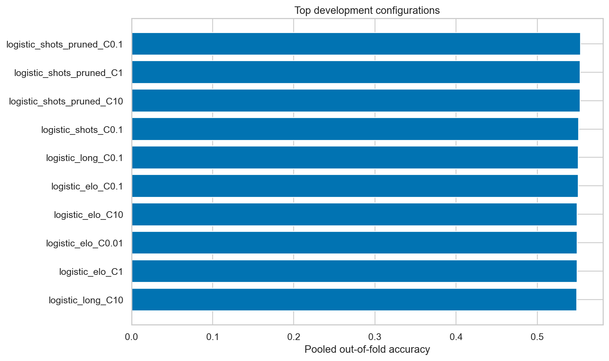
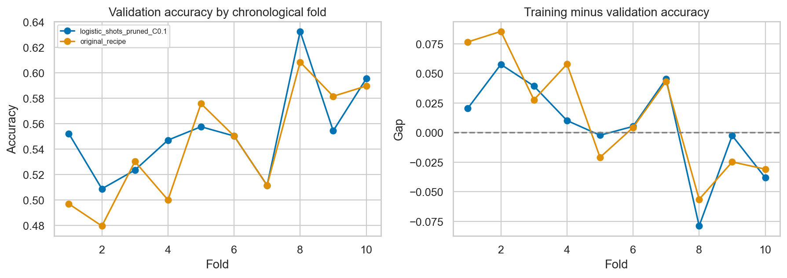
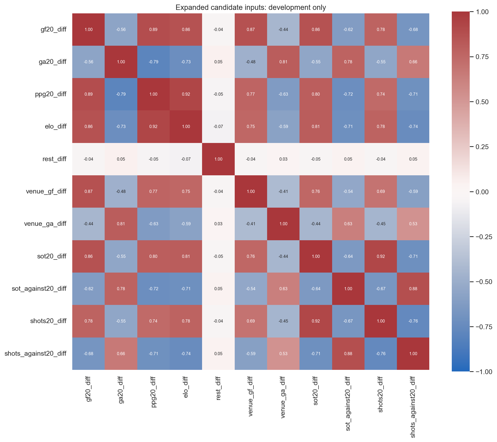
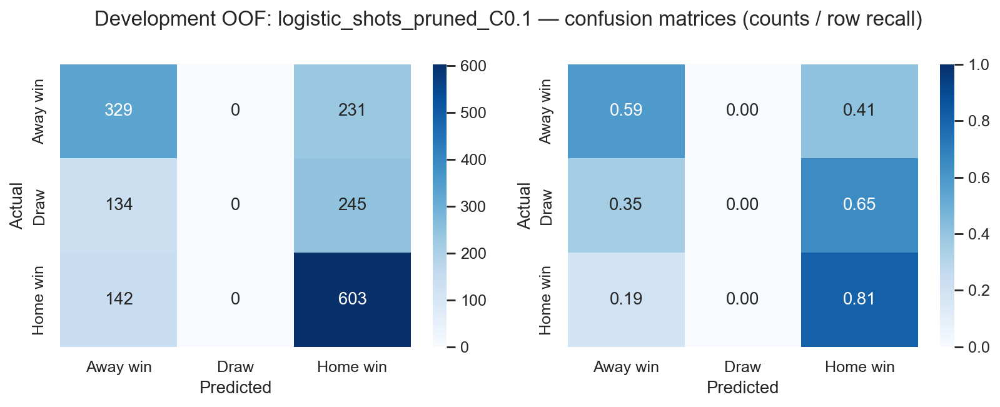
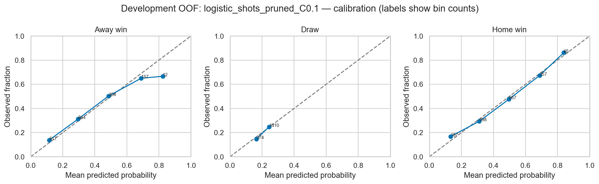
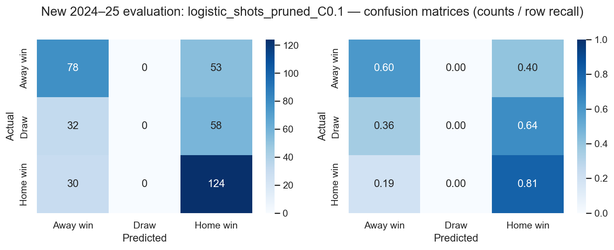
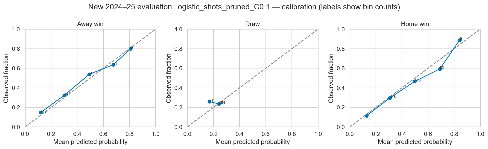
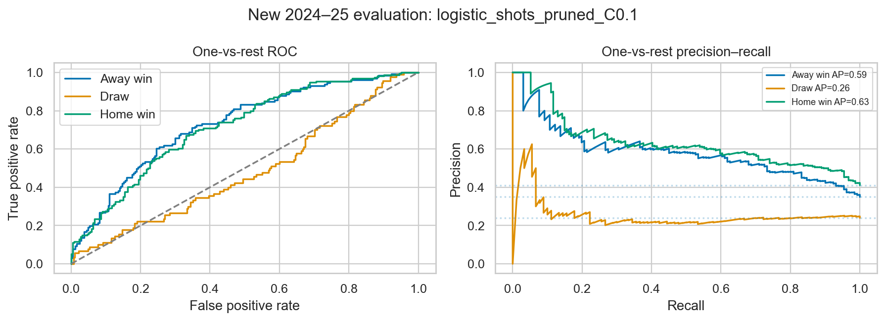
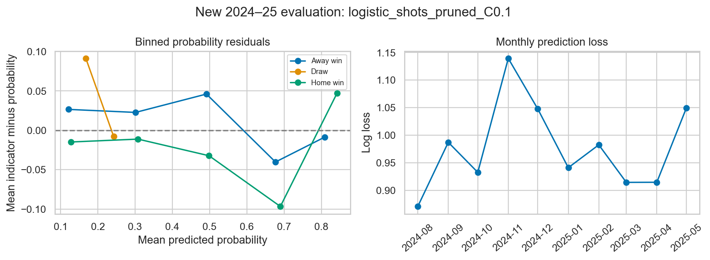

## What changed

We tested a genuine improvement attempt after the original 56.5% accuracy result. The new experiment uses 4,180 fixtures from eleven complete seasons from Football-Data.co.uk (2014–15 through 2024–25). Two seasons initialize history; 2,985 eligible fixtures from 2016–24 train and validate models. One completely blank row in the 2014–15 source is dropped. Optional shot values are imputed within folds if missing. Valid extreme results remain.

The old 2023–24 test is now explicitly development data. The new evaluation is 2024–25, selected before its prediction scores were computed. Earlier results within an evaluation block update later pre-match histories; model parameters remain fixed. No betting odds or current-match shots are used. The original reports and draw-focused follow-up remain intact.

## Development evidence and selected model

Ten expanding chronological folds compare 42 configurations. Accuracy is now the primary objective, with log loss breaking ties. This was changed explicitly following the user's request, not secretly after seeing test rankings. The selected model is logistic_shots_pruned_C0.1, with OOF accuracy 55.34%, compared with 54.28% for the old recipe refitted on the same development rows. Candidate models include multinomial logistic regression, decision trees and random forests; complexity does not guarantee higher accuracy.

New features use 20-match goals, points and shot rates, plus ten venue-specific games, Elo and rest. All statistics are lagged by date. Tests perturb current and future scores/shots and verify past/current inputs do not change. The older five-game recipe is a fair same-data comparator, not the exact frozen 2023–24 model.

## Collinearity and diagnostic refinement

The full eleven-input design has redundant information, with VIFs up to 14.44. Before opening the new test, four additional logistic configurations applied training-only VIF pruning after median imputation. They are included in the 42-model comparison; selection remains based on OOF accuracy. The selected inputs are: ga20_diff, elo_diff, rest_diff, venue_gf_diff, venue_ga_diff, shots20_diff, shots_against20_diff.

The selected pruned model retains seven predictors with final VIFs from 1.01 to 4.90, all below the declared threshold of 5. Its OOF accuracy is 55.34%, compared with 55.11% for the unpruned shot model. This is a small observed improvement, not proof that VIF pruning always helps. L2 regularization and remaining correlation still limit individual coefficient interpretation. Calibration, confusion and train–validation gaps are shown, not used to tune against the new test.

## New-season evaluation

| name | accuracy | macro_f1 | draw_recall | log_loss | auc_macro_ovr |
| --- | --- | --- | --- | --- | --- |
| logistic_shots_pruned_C0.1 | 0.5387 | 0.4044 | 0.0000 | 0.9880 | 0.6420 |
| original_recipe | 0.5253 | 0.3907 | 0.0000 | 0.9913 | 0.6418 |
| prior | 0.4107 | 0.1941 | 0.0000 | 1.0793 | 0.5000 |

On 375 identical eligible 2024–25 fixtures, the selected model scores 53.87% accuracy; the refitted original recipe scores 52.53%; the prior baseline scores 41.07%. The paired difference versus the old recipe is +1.33 percentage points. Its approximate week-block 95% interval is [-1.33, +4.30] points. An interval containing zero does not establish a reliable improvement.

The original 56.5% was measured on 2023–24. Comparing that number with this season's accuracy is not a controlled improvement estimate. Use the same-season comparator above. We report the result whether better or worse and do not choose another model after seeing it.

## What to tell the professor

We expanded training history, tested richer pre-match information, compared 42 configurations with chronological CV, checked redundancy and locked selection before evaluating a new season. The selected model's new-season draw recall is 0.0%, so accuracy alone still hides an important weakness. The separate draw-refinement experiment explores a different objective; do not mix its metrics with this accuracy experiment.

Limits: match outcomes remain uncertain; there are no lineups, injuries or player-strength variables. Relegated teams can carry stale history from earlier Premier League seasons. Five-game warm-up still excludes newly observed teams: evaluate only eligible fixtures and state the denominator. A larger search can overfit validation; the fresh season is the assessment. These results do not support promising substantially higher accuracy. A change of target (such as excluding draws) would be a different task, not an improvement on this one.

Source: https://www.football-data.co.uk/englandm.php. File URLs and checksums are in data/expanded/provenance.json. See experiments/PROTOCOL.md for the prespecified plan and development-only refinement.
